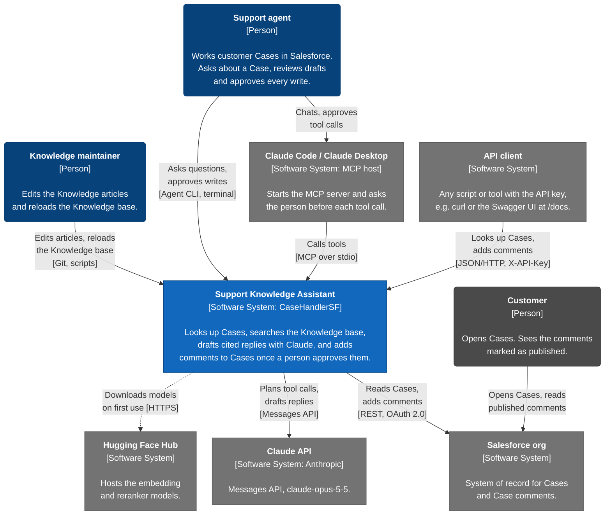

# Architecture

[C4](https://c4model.com) diagrams of the Support Knowledge Assistant (this repository) at two levels:

1. **System context**: who uses the assistant and which outside systems it depends on.
2. **Containers**: the parts that run or store data separately, and how they talk to each other.

The diagrams are written in Mermaid, which GitHub draws from the text below; edit the text to change them. In both, "Support agent" is the person. The AI agent is the Agent CLI container.

## 1. System context

- A support agent reaches the assistant in two ways: the Agent CLI in a terminal, or an MCP host such as Claude Code. The Agent CLI always asks a person before it writes to Salesforce. MCP hosts ask before each tool call, unless the tool has been set to always allow.
- API clients use the HTTP API to read Cases and add comments. That path uses neither Claude nor the Knowledge base.
- Customers never use the assistant, but they write the Case subjects and descriptions it reads. Both prompts tell Claude to treat that text as information, not instructions.

## 2. Containers

```mermaid
%%{init: {"flowchart": {"wrappingWidth": 480, "nodeSpacing": 30, "rankSpacing": 40}}}%%
flowchart TB
    maintainer("<b>Knowledge maintainer</b><br/>[Person]")
    agent("<b>Support agent</b><br/>[Person]")
    mcphost["<b>Claude Code / Claude Desktop</b><br/>[Software System: MCP host]"]
    apiclient["<b>API client</b><br/>[Software System]"]

    subgraph ska[" "]
        title["<b>Support Knowledge Assistant</b><br/>[Software System]"]
        loader["<b>Knowledge loader</b><br/>[Container: Python scripts]<br/><br/>Run by hand: build_knowledge.py,<br/>then embed_to_pgvector.py. Chunks<br/>by heading, embeds with bge-small,<br/>rebuilds the chunks table."]
        articles[("<b>Knowledge articles</b><br/>[Container: Markdown in Git]<br/><br/>47 articles with YAML front<br/>matter, and the knowledge.jsonl<br/>built from them")]
        kb[("<b>Knowledge base</b><br/>[Container: PostgreSQL + pgvector]<br/><br/>Postgres 17 in Docker. chunks table:<br/>article number, title, text and<br/>a 384-number embedding")]
        cli["<b>Agent CLI</b><br/>[Container: Python, Anthropic SDK]<br/><br/>casehandlersf-agent. Tool-use loop,<br/>at most 5 calls to Claude. A person<br/>approves each update_case first."]
        log[("<b>Agent run log</b><br/>[Container: JSON Lines file]<br/><br/>logs/agent_runs.jsonl: model calls,<br/>tool calls, approvals, timings")]
        mcp["<b>MCP server</b><br/>[Container: Python, MCP SDK]<br/><br/>casehandlersf-mcp. Tools: get_case,<br/>search_knowledge, draft_reply,<br/>update_case. Hybrid search: pgvector<br/>+ in-memory BM25, merged with RRF,<br/>then a local reranker."]
        api["<b>HTTP API</b><br/>[Container: FastAPI, Docker]<br/><br/>GET /cases/{key}<br/>POST /cases/{key}/comments<br/>GET /health"]
    end

    claude["<b>Claude API</b><br/>[Software System: Anthropic]<br/><br/>Messages API, claude-opus-5-5"]
    sf["<b>Salesforce org</b><br/>[Software System]<br/><br/>Cases and CaseComments. Integration<br/>user with the CaseHandler_API_Read<br/>and CaseHandler_API_Comment<br/>permission sets."]
    hf["<b>Hugging Face Hub</b><br/>[Software System]<br/><br/>bge-small-en-v1.5 embeddings,<br/>ms-marco-MiniLM-L-6-v2 reranker"]

    %% Invisible link: puts the boundary's name at its bottom edge, clear of the arrows.
    articles ~~~ title
    maintainer -->|"Edits<br/>[Git]"| articles
    maintainer -.->|"Runs after edits"| loader
    loader -->|"Reads"| articles
    loader -->|"Rebuilds all chunks<br/>[SQL, pgvector]"| kb
    loader -.->|"Downloads the<br/>embedding model<br/>[HTTPS]"| hf
    agent -->|"Asks a question,<br/>approves or rejects<br/>each write [terminal]"| cli
    agent -->|"Chats, approves<br/>tool calls"| mcphost
    cli -->|"Appends events<br/>[JSON Lines]"| log
    cli -->|"Lists and calls tools<br/>[in-process calls]"| mcp
    mcphost -->|"Calls tools<br/>[MCP over stdio]"| mcp
    mcp -->|"Loads chunks,<br/>vector search<br/>[SQL, pgvector]"| kb
    mcp -.->|"Downloads models<br/>on first search<br/>[HTTPS]"| hf
    cli -->|"Plans tool calls,<br/>one call per step<br/>[Messages API]"| claude
    mcp -->|"Drafts replies<br/>[Messages API]"| claude
    mcp -->|"Reads Cases,<br/>adds comments<br/>[REST, OAuth 2.0]"| sf
    apiclient -->|"Looks up Cases,<br/>adds comments<br/>[JSON/HTTP, X-API-Key]"| api
    api -->|"Reads Cases,<br/>adds comments<br/>[REST, OAuth 2.0]"| sf

    classDef person fill:#08427B,stroke:#073B6F,color:#fff
    classDef container fill:#2F78C4,stroke:#2563A6,color:#fff
    classDef external fill:#737373,stroke:#5C5C5C,color:#fff
    classDef boundaryTitle fill:none,stroke:none
    class agent,maintainer person
    class loader,articles,kb,cli,log,mcp,api container
    class mcphost,apiclient,hf,claude,sf external
    class title boundaryTitle
    style ska fill:none,stroke:#1168BD,stroke-width:2px,stroke-dasharray:6 4
```

- The Agent CLI imports the MCP server's tools and calls them in its own process, without stdio. They are drawn as two containers because Claude Code and Claude Desktop start the MCP server on its own.
- Two paths write to Salesforce: `update_case` in the MCP server and `POST /cases/{key}/comments` in the HTTP API. Both use the Salesforce credentials in `.env`, so both act as the integration user, which can read Cases and edit them (needed to add comments) but not delete them.
- Search runs mostly inside the MCP server. On the first search it loads every chunk from Postgres and builds the BM25 keyword index in memory. Each query is embedded and its results reranked locally; Postgres only does the vector search. Hugging Face is contacted only to download the two models the first time.
- The Knowledge base is derived data: the articles in Git are the source, and the loader rebuilds the `chunks` table from them. The loader and the MCP server must embed with the same model (`BAAI/bge-small-en-v1.5`), which is set in both [`experiments/embed_to_pgvector.py`](../../experiments/embed_to_pgvector.py) and [`src/casehandlersf/knowledge.py`](../src/casehandlersf/knowledge.py).
- As set up in this repository, everything runs on one machine: Postgres from [`experiments/compose.yaml`](../../experiments/compose.yaml), the HTTP API from [`compose.yaml`](../compose.yaml), and the Agent CLI, MCP server and loader as local Python processes.

Not shown: the CSV summary CLI (`casehandlersf`), which reads an exported file and talks to nothing else; the other scripts in `experiments/`, which evaluate retrieval and answers; and CI, which tests the code and builds the image but deploys nothing.

## Key

| Element | Drawn as |
|---|---|
| Person | Dark blue rounded box; grey for the customer, who is outside the company |
| The assistant and its containers | Blue box; data stores are cylinders |
| External system | Grey box |
| Arrow | Points from the caller. The label says what it does, then [how]. Dotted: run by hand, or only on first use |
